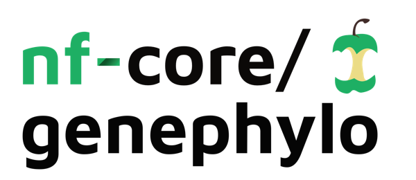

<h1>
  <picture>
    <source media="(prefers-color-scheme: dark)" srcset="docs/images/nf-core-genephylo_logo_dark.png">
    
  </picture>
</h1>

[](https://github.com/codespaces/new/nf-core/genephylo)
[](https://github.com/nf-core/genephylo/actions/workflows/nf-test.yml)
[](https://github.com/nf-core/genephylo/actions/workflows/linting.yml)[](https://nf-co.re/genephylo/results)[](https://doi.org/10.5281/zenodo.XXXXXXX)
[](https://www.nf-test.com)

[](https://www.nextflow.io/)
[](https://github.com/nf-core/tools/releases/tag/4.2.1)
[](https://docs.conda.io/en/latest/)
[](https://www.docker.com/)
[](https://sylabs.io/docs/)
[](https://cloud.seqera.io/launch?pipeline=https://github.com/nf-core/genephylo)

[](https://nfcore.slack.com/channels/genephylo)[](https://bsky.app/profile/nf-co.re)[](https://mstdn.science/@nf_core)[](https://www.youtube.com/c/nf-core)

## Introduction

**nf-core/genephylo** is a bioinformatics pipeline that retrieves the orthologs of one or more genes of interest across species and builds codon-aware alignments and phylogenetic trees for them. Starting from one seed sequence per gene, it searches a BLAST database for homologs, assigns them to species, extracts their coding sequences, and uses gene/species tree reconciliation to isolate the orthogroup of each gene. Its outputs are designed as inputs for evolutionary analyses, such as those run by nf-core/genephylomodeler.

<!-- TODO nf-core: Include a figure that guides the user through the major workflow steps. Many nf-core
     workflows use the "tube map" design for that. See https://nf-co.re/docs/community/brand/workflow-schematics#examples for examples.   -->

1. Prepare a BLAST database: download one from NCBI, build one from your own sequences, or use an existing one ([`BLAST+`](https://blast.ncbi.nlm.nih.gov/))
2. Search for homologs of each seed gene (`blastn` or `tblastn`) and retrieve their sequences ([`BLAST+`](https://blast.ncbi.nlm.nih.gov/)), removing duplicates ([`SeqKit`](https://bioinf.shenwei.me/seqkit/))
3. Assign species from the NCBI taxonomy and rename sequences as `SPECIES|GENE|ACCESSION` ([`ETE 3`](http://etetoolkit.org/))
4. Extract the coding sequence, keeping the longest ORF per sequence ([`TD2`](https://github.com/Markusjsommer/TD2))
5. Initial alignment ([`MAFFT`](https://mafft.cbrc.jp/alignment/software/)) and fast gene tree ([`FastTree`](http://www.microbesonline.org/fasttree/))
6. Reconcile the gene tree with the species tree ([`Treerecs`](https://project.inria.fr/treerecs/)) and select the orthogroup of each seed gene
7. Final alignment of the orthogroup ([`MAFFT`](https://mafft.cbrc.jp/alignment/software/)), refined codon by codon ([`MACSE`](https://www.agap-ge2pop.org/macse/))
8. Final maximum-likelihood tree ([`IQ-TREE`](http://www.iqtree.org/))

## Usage

> [!NOTE]
> If you are new to Nextflow and nf-core, please refer to [this page](https://nf-co.re/docs/get_started/environment_setup/overview) on how to set-up Nextflow. Make sure to [test your setup](https://nf-co.re/docs/get_started/run-your-first-pipeline) with `-profile test` before running the workflow on actual data.

First, prepare a samplesheet with one row per gene of interest:

`samplesheet.csv`:

```csv
id,fastafile
TSTG1,TSTG1_nt.fasta
TSTG2,TSTG2_nt.fasta
```

Each row represents one gene (not a sample). `id` is the gene name, used to name all output files. `fastafile` contains a single seed sequence for that gene: a nucleotide CDS with `--blast_type nt`, or a protein sequence with `--blast_type aa`.

You also need a species tree in Newick format (`.nwk`) whose leaf names are species codes (first 3 letters of the genus + first 3 letters of the species, e.g. `HOMSAP` for _Homo sapiens_; for three-part names, 3 + 2 + 1 letters, e.g. `CANLUF` for _Canis lupus familiaris_).

Now, you can run the pipeline using:

```bash
nextflow run nf-core/genephylo \
   -profile <docker/singularity/.../institute> \
   --input samplesheet.csv \
   --blastdb_option build \
   --blastdb_build sequences.fasta \
   --blastdb_buildmap taxid_map.txt \
   --species_tree species_tree.nwk \
   --outdir <OUTDIR>
```

`--blastdb_option` selects how the BLAST database is provided: `build` (from your own sequences, as above), `update` (download a pre-formatted NCBI database, set with `--blastdb_update`) or `current` (an existing database, given with `--blastdb_dir`).

`--taxdump` is optional. By default, the pipeline downloads the NCBI taxonomy at runtime. If the pipeline's tasks have no internet access (e.g. on offline compute nodes or behind some VPNs), or to keep the same taxonomy version across runs, download [`taxdump.tar.gz`](https://ftp.ncbi.nih.gov/pub/taxonomy/taxdump.tar.gz) yourself and pass it with `--taxdump /path/to/taxdump.tar.gz`.

> [!WARNING]
> Please provide pipeline parameters via the CLI or Nextflow `-params-file` option. Custom config files including those provided by the `-c` Nextflow option can be used to provide any configuration _**except for parameters**_; see [docs](https://nf-co.re/docs/running/run-pipelines#using-parameter-files).

For more details and further functionality, please refer to the [usage documentation](https://nf-co.re/genephylo/usage) and the [parameter documentation](https://nf-co.re/genephylo/parameters).

## Pipeline output

To see the results of an example test run with a full size dataset refer to the [results](https://nf-co.re/genephylo/results) tab on the nf-core website pipeline page.
For more details about the output files and reports, please refer to the
[output documentation](https://nf-co.re/genephylo/output).

## Credits

nf-core/genephylo was originally written by Lea Picard.

We thank the following people for their extensive assistance in the development of this pipeline:

<!-- TODO nf-core (@Lea): If applicable, make list of people who have also contributed -->

## Contributions and Support

If you would like to contribute to this pipeline, please see the [contributing guidelines](docs/CONTRIBUTING.md).

For further information or help, don't hesitate to get in touch on the [Slack `#genephylo` channel](https://nfcore.slack.com/channels/genephylo) (you can join with [this invite](https://nf-co.re/join/slack)).

## Citations

<!-- TODO nf-core: Add citation for pipeline after first release. Uncomment lines below and update Zenodo doi and badge at the top of this file. -->
<!-- If you use nf-core/genephylo for your analysis, please cite it using the following doi: [10.5281/zenodo.XXXXXX](https://doi.org/10.5281/zenodo.XXXXXX) -->

An extensive list of references for the tools used by the pipeline can be found in the [`CITATIONS.md`](CITATIONS.md) file.

You can cite the `nf-core` publication as follows:

> **The nf-core framework for community-curated bioinformatics pipelines.**
>
> Philip Ewels, Alexander Peltzer, Sven Fillinger, Harshil Patel, Johannes Alneberg, Andreas Wilm, Maxime Ulysse Garcia, Paolo Di Tommaso & Sven Nahnsen.
>
> _Nat Biotechnol._ 2020 Feb 13. doi: [10.1038/s41587-020-0439-x](https://dx.doi.org/10.1038/s41587-020-0439-x).
